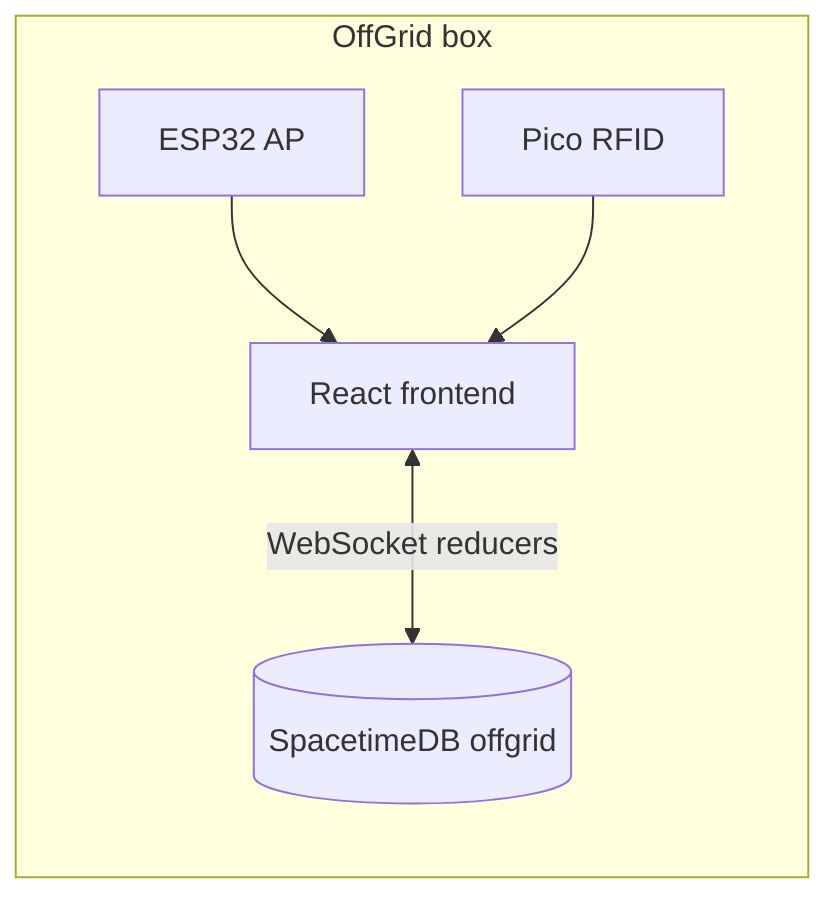

# Architecture

## Problem

Corporate network is untrusted. The **OffGrid box** provides a backup LAN: ESP32 captive portal, RFID gate, and a local **SpacetimeDB** module so the team can coordinate without the compromised WAN.

## Data plane

## Module (backend)

Tables and reducers live in `backend/spacetime/src/index.ts`: members, machines, assets, incidents, tasks, messages, legal deadlines, lead join codes, panic, etc.

## Frontend

- `VITE_MOCK=true` — `localStorage` demo store (`storeMock.ts`).
- `VITE_MOCK=false` — live subscriptions + reducers via `src/stdb/` (`StdbProvider`, `mapToState`, `actions`).

Employee roster still uses UI seed data until bound to `member` rows; machines/assets overlay from Spacetime when connected.

## Hardware

- **ESP32** (`hardware/esp32/`): isolated SSID; employee **kit laptops** and the admin console join only this LAN and open the dashboard (no other network).
- **Pico** (reference in teammate bundle): MFRC522 RFID, optional HID keyboard for join codes.

See `docs/FRONTEND_CONTRACT.md` for UI ↔ reducer naming notes.
